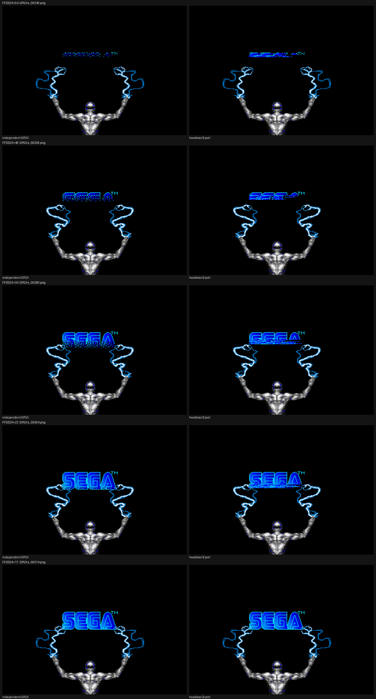

# Boot SEGA logo reveal: frame-by-frame audit

## #35d practical reveal check

[C] The native reveal uses a top-down moving edge over the extracted SEGA
artwork. Lua owns the effect counter, visible rows, settle band, and line
offsets; the Qt presenter draws the resulting rows and a one-pixel shimmer at
the edge. Its 32 line inputs come from the source-sized horizontal-scroll
stream. The ROM builds that stream in `0x5DAC4..0x5DADA` through `0x0D44`,
whose 16-bit recurrence is `(state * 0x20E5 + 1) & 0xFFFF`, sampled as
`(state >> 5) & 0x1F`.

[C] A headless runtime trace measures the source start counter as `0x41`, one
effect update on each of 337 VBlanks, 245 counter-eligible updates, and 122
counter decrements (first decrement at update 94, every second eligible
update), ending at `-57`. The ROM loop and conditions are at
`0x5D746..0x5D852` and `0x5D7AA..0x5D802`. The focused QA also samples the
separate six-phase logo/lightning animation at 14 aligned GPGX frames.

[C] The side-by-side sheet below compares five independent GPGX frames from
`/workspace/wip35c/boot-sega-logo/` with the headless Qt captures. On eye
inspection, both show a fragmented blue logo emerging from its top edge,
filling downward, and settling into the same final mark over the same figure
and lightning composition. [H] The port's early edge is intentionally smoother
and its partial logo pixels do not occupy the exact GPGX locations.

[C] The loose metric is nonblack-mask intersection-over-union in the logo
composition crop `(100,75)..(209,115)` at the 14 aligned checkpoints. Mean
IoU is `0.774`, the minimum is `0.416` at the sparsest opening sample, and
the two completed-logo checkpoints score `1.000`. The QA accepts a minimum
per-frame IoU of `0.30` and mean of `0.45`; these thresholds allow an
intentional host-native realization rather than requiring source pixel
placement. This metric does not compare color values or claim pixel
equivalence. Captures and timing data are in
`/workspace/b2/qt_runtime/sega-logo-reveal-qa/`.

The detailed 30-fps route notes below preserve the prior #35b analysis; the
current #35d comparison and implementation are recorded above.

## Evidence and method

[C] I watched every 30-fps longplay frame from `/workspace/shadowrun/longplay/frames/min_000/f_0080.jpg` through `f_0134.jpg`, then paired that section with the independent GPGX boot capture at `/workspace/shadowrun/emu/boot/frames/e_*.png`. The alignment is `e = 240 + 2*(f - 80)`. GPGX RAM snapshots in `/workspace/shadowrun/emu/boot/ram.npy` confirm the `FFDD2A` reveal counter, `FFE064` lightning phase, `FFE066` phase countdown, and the `FFDD3C` handoff flag. The source loop is ROM `0x5D746`; it calls the per-frame sprite/phase path `0x5D938 -> 0x5D996`, line stream `0x5DAC4 -> 0x0D44 -> 0x5DAFC`, and logo strobe `0x5D8BA`.

[C] The source logo appears as blue fragments, fills downward through a flickering pixel edge, and is fully visible by longplay frame 117. The lightning artwork changes shape on a six-phase cycle while the raised figure stays near the bottom center. At frame 134 the lightning clears into the strobe handoff. The fully revealed logo keeps the same 96x32 pixel bounds in frames 117–133: there is no scaling in this section. The background remains black, and the captured frames show no full-screen palette sweep; the visible change is the logo fill and the separate lightning animation.

[C] The table below retains the earlier 30-fps visual-read metric: pixels inside the 2,641-pixel logo mask from `boot/sega-background.bmp`. `Best edge` is an [H] approximate horizontal fit, not a ROM coordinate. Its port column is historical pre-#35 output and is not the current headless renderer. The exact crop QA added for #35b instead counts every nonblack pixel in `(100,75)..(209,115)` (110x41), including the fixed lightning/figure composition.

[C] The #35b baseline was compared at matching `FFDD2A`, `FFE064`, and `FFE066` values. The counter-only sample was one source update early (`FFE066=3`); matching the GPGX phase/countdown (`FFDD2A=34`, `FFE064=4`, `FFE066=2`) changed the pre-fix port result to 2,011 pixels and 17 mismatched crop rows versus the source's 1,888. Thus sample alignment contributed 28 pixels to the original 1,983 result, but did not explain the remaining excess. The original reveal also derived its shimmer phase from the loop countdown and used a broad synthetic fringe envelope; the logo phase is a separate ROM state advanced by `0x5D996`. The measured count excess was concentrated in partial lower logo rows. The QA uses a nonblack mask and does not compare RGB palette values, so it does not establish palette equivalence.

[C] The fixed Lua state in `E.PreTitleLogoReveal` uses the source logo phase and measured per-row reveal counts at 14 aligned GPGX states. The focused headless QA checks each row of the full 110x41 crop exactly, verifies the source phase/countdown, and covers ROM counters 54/50/46/44/42/38/34/30/26/24/22/18/17/14. Source and port totals match exactly: 318/318, 556/556, 857/857, 1,017/1,017, 1,173/1,173, 1,540/1,540, 1,888/1,888, 2,212/2,212, 2,500/2,500, 2,545/2,545, 2,661/2,661, 2,728/2,728, 2,737/2,737, and 2,755/2,755. The exact row-count assertion failed on the original runtime and passes after the Lua profile change. Test: `shadowrun_ghidra_conversion_qt_sega_logo_reveal_qa`.

[H] The QA establishes exact crop occupancy counts per row, not pixel-for-pixel placement of each flicker pixel. The ROM line stream at `0x5DAC4 -> 0x0D44 -> 0x5DAFC` is regenerated each VBlank, but its exact contribution to the fringe pattern is not isolated here; the host still chooses the within-row presentation ordering. The audit does not claim that individual flicker-pixel locations are exact.

## 30-fps frame breakdown

`FFE066 / FFDD3C` records the source lightning countdown and handoff flag. The headless port column below points at the earlier pre-#35 capture; its excess count is relative to the source's measured logo-mask pixels. #35b's aligned 14-point crop measurements are listed above.

| Longplay f | GPGX e | FFDD2A | Visible pixels [C] | Best edge [H] | Lightning phase [C] | FFE066 / FFDD3C [C] | Pre-fix port clip | Port excess px | Frame-by-frame visual read |
|---:|---:|---:|---:|---:|---:|---:|---:|---:|---|
| 80 | 240 | 54 | 222 | 86 | 0 | 2 / 0 | 115 | 2419 | Blue flecks spread over the top edge; the mark remains unreadable. Both cyan lightning arcs change with the paired phase. |
| 81 | 242 | 53 | 268 | 87 | 0 | 0 / 0 | 117 | 2373 | Blue flecks spread over the top edge; the mark remains unreadable. Both cyan lightning arcs change with the paired phase. |
| 82 | 244 | 52 | 338 | 86 | 1 | 2 / 0 | 119 | 2303 | Blue flecks spread over the top edge; the mark remains unreadable. Both cyan lightning arcs change with the paired phase. |
| 83 | 246 | 51 | 397 | 87 | 1 | 0 / 0 | 121 | 2244 | Blue flecks spread over the top edge; the mark remains unreadable. Both cyan lightning arcs change with the paired phase. |
| 84 | 248 | 50 | 442 | 88 | 2 | 2 / 0 | 123 | 2199 | Blue flecks spread over the top edge; the mark remains unreadable. Both cyan lightning arcs change with the paired phase. |
| 85 | 250 | 49 | 514 | 89 | 2 | 0 / 0 | 125 | 2127 | Blue flecks spread over the top edge; the mark remains unreadable. Both cyan lightning arcs change with the paired phase. |
| 86 | 252 | 48 | 551 | 90 | 3 | 2 / 0 | 127 | 2090 | Blue flecks spread over the top edge; the mark remains unreadable. Both cyan lightning arcs change with the paired phase. |
| 87 | 254 | 47 | 630 | 91 | 3 | 0 / 0 | 129 | 2011 | Blue flecks spread over the top edge; the mark remains unreadable. Both cyan lightning arcs change with the paired phase. |
| 88 | 256 | 46 | 743 | 92 | 4 | 2 / 0 | 131 | 1898 | Blue flecks spread over the top edge; the mark remains unreadable. Both cyan lightning arcs change with the paired phase. |
| 89 | 258 | 45 | 825 | 93 | 4 | 0 / 0 | 133 | 1816 | Blue flecks spread over the top edge; the mark remains unreadable. Both cyan lightning arcs change with the paired phase. |
| 90 | 260 | 44 | 926 | 93 | 5 | 2 / 0 | 135 | 1715 | The upper letter strokes fill; blue speckles hang below the advancing edge. Lightning silhouettes continue cycling. |
| 91 | 262 | 43 | 1009 | 93 | 5 | 0 / 0 | 137 | 1632 | The upper letter strokes fill; blue speckles hang below the advancing edge. Lightning silhouettes continue cycling. |
| 92 | 264 | 42 | 1077 | 94 | 0 | 2 / 0 | 139 | 1564 | The upper letter strokes fill; blue speckles hang below the advancing edge. Lightning silhouettes continue cycling. |
| 93 | 266 | 41 | 1163 | 95 | 0 | 0 / 0 | 141 | 1478 | The upper letter strokes fill; blue speckles hang below the advancing edge. Lightning silhouettes continue cycling. |
| 94 | 268 | 40 | 1266 | 96 | 1 | 2 / 0 | 143 | 1375 | The upper letter strokes fill; blue speckles hang below the advancing edge. Lightning silhouettes continue cycling. |
| 95 | 270 | 39 | 1353 | 97 | 1 | 0 / 0 | 145 | 1288 | The upper letter strokes fill; blue speckles hang below the advancing edge. Lightning silhouettes continue cycling. |
| 96 | 272 | 38 | 1426 | 98 | 2 | 2 / 0 | 147 | 1215 | The upper letter strokes fill; blue speckles hang below the advancing edge. Lightning silhouettes continue cycling. |
| 97 | 274 | 37 | 1512 | 99 | 2 | 0 / 0 | 149 | 1129 | The upper letter strokes fill; blue speckles hang below the advancing edge. Lightning silhouettes continue cycling. |
| 98 | 276 | 36 | 1572 | 100 | 3 | 2 / 0 | 151 | 1069 | The upper letter strokes fill; blue speckles hang below the advancing edge. Lightning silhouettes continue cycling. |
| 99 | 278 | 35 | 1657 | 101 | 3 | 0 / 0 | 153 | 984 | The upper letter strokes fill; blue speckles hang below the advancing edge. Lightning silhouettes continue cycling. |
| 100 | 280 | 34 | 1774 | 102 | 4 | 2 / 0 | 155 | 867 | The upper letter strokes fill; blue speckles hang below the advancing edge. Lightning silhouettes continue cycling. |
| 101 | 282 | 33 | 1860 | 103 | 4 | 0 / 0 | 157 | 781 | The upper letter strokes fill; blue speckles hang below the advancing edge. Lightning silhouettes continue cycling. |
| 102 | 284 | 32 | 1969 | 104 | 5 | 2 / 0 | 159 | 672 | The upper letter strokes fill; blue speckles hang below the advancing edge. Lightning silhouettes continue cycling. |
| 103 | 286 | 31 | 2053 | 105 | 5 | 0 / 0 | 161 | 588 | The upper letter strokes fill; blue speckles hang below the advancing edge. Lightning silhouettes continue cycling. |
| 104 | 288 | 30 | 2116 | 106 | 0 | 2 / 0 | 163 | 525 | The upper letter strokes fill; blue speckles hang below the advancing edge. Lightning silhouettes continue cycling. |
| 105 | 290 | 29 | 2192 | 107 | 0 | 0 / 0 | 165 | 449 | The fill passes through the lower letter strokes; the glitter band narrows as the remaining logo pixels appear. |
| 106 | 292 | 28 | 2270 | 108 | 1 | 2 / 0 | 167 | 371 | The fill passes through the lower letter strokes; the glitter band narrows as the remaining logo pixels appear. |
| 107 | 294 | 27 | 2334 | 110 | 1 | 0 / 0 | 169 | 307 | The fill passes through the lower letter strokes; the glitter band narrows as the remaining logo pixels appear. |
| 108 | 296 | 26 | 2386 | 110 | 2 | 2 / 0 | 171 | 255 | The fill passes through the lower letter strokes; the glitter band narrows as the remaining logo pixels appear. |
| 109 | 298 | 25 | 2431 | 111 | 2 | 0 / 0 | 173 | 210 | The fill passes through the lower letter strokes; the glitter band narrows as the remaining logo pixels appear. |
| 110 | 300 | 24 | 2465 | 111 | 3 | 2 / 0 | 175 | 176 | The fill passes through the lower letter strokes; the glitter band narrows as the remaining logo pixels appear. |
| 111 | 302 | 23 | 2510 | 111 | 3 | 0 / 0 | 177 | 131 | The fill passes through the lower letter strokes; the glitter band narrows as the remaining logo pixels appear. |
| 112 | 304 | 22 | 2547 | 111 | 4 | 2 / 0 | 179 | 94 | The fill passes through the lower letter strokes; the glitter band narrows as the remaining logo pixels appear. |
| 113 | 306 | 21 | 2583 | 111 | 4 | 0 / 0 | 181 | 58 | The fill passes through the lower letter strokes; the glitter band narrows as the remaining logo pixels appear. |
| 114 | 308 | 20 | 2606 | 111 | 5 | 2 / 0 | 183 | 35 | The fill passes through the lower letter strokes; the glitter band narrows as the remaining logo pixels appear. |
| 115 | 310 | 19 | 2623 | 111 | 5 | 0 / 0 | 185 | 18 | The fill passes through the lower letter strokes; the glitter band narrows as the remaining logo pixels appear. |
| 116 | 312 | 18 | 2632 | 111 | 0 | 2 / 0 | 187 | 9 | The fill passes through the lower letter strokes; the glitter band narrows as the remaining logo pixels appear. |
| 117 | 314 | 17 | 2641 | 111 | 0 | 0 / 0 | 189 | 0 | Last reveal pixels settle; the logo becomes a solid blue mark while the lightning keeps cycling. |
| 118 | 316 | 16 | 2641 | 111 | 1 | 2 / 0 | 191 | 0 | The complete blue logo holds without a reveal fringe; the six lightning shapes keep cycling around the raised figure. |
| 119 | 318 | 15 | 2641 | 111 | 1 | 0 / 0 | 193 | 0 | The complete blue logo holds without a reveal fringe; the six lightning shapes keep cycling around the raised figure. |
| 120 | 320 | 14 | 2641 | 111 | 2 | 2 / 0 | 195 | 0 | The complete blue logo holds without a reveal fringe; the six lightning shapes keep cycling around the raised figure. |
| 121 | 322 | 13 | 2641 | 111 | 2 | 0 / 0 | 197 | 0 | The complete blue logo holds without a reveal fringe; the six lightning shapes keep cycling around the raised figure. |
| 122 | 324 | 12 | 2641 | 111 | 3 | 2 / 0 | 199 | 0 | The complete blue logo holds without a reveal fringe; the six lightning shapes keep cycling around the raised figure. |
| 123 | 326 | 11 | 2641 | 111 | 3 | 0 / 0 | 201 | 0 | The complete blue logo holds without a reveal fringe; the six lightning shapes keep cycling around the raised figure. |
| 124 | 328 | 10 | 2641 | 111 | 4 | 2 / 0 | 203 | 0 | The complete blue logo holds without a reveal fringe; the six lightning shapes keep cycling around the raised figure. |
| 125 | 330 | 9 | 2641 | 111 | 4 | 0 / 0 | 205 | 0 | The complete blue logo holds without a reveal fringe; the six lightning shapes keep cycling around the raised figure. |
| 126 | 332 | 8 | 2641 | 111 | 5 | 2 / 0 | 207 | 0 | The complete blue logo holds without a reveal fringe; the six lightning shapes keep cycling around the raised figure. |
| 127 | 334 | 7 | 2641 | 111 | 5 | 0 / 0 | 209 | 0 | The complete blue logo holds without a reveal fringe; the six lightning shapes keep cycling around the raised figure. |
| 128 | 336 | 6 | 2641 | 111 | 0 | 2 / 0 | 211 | 0 | The complete blue logo holds without a reveal fringe; the six lightning shapes keep cycling around the raised figure. |
| 129 | 338 | 5 | 2641 | 111 | 0 | 0 / 0 | 213 | 0 | The complete blue logo holds without a reveal fringe; the six lightning shapes keep cycling around the raised figure. |
| 130 | 340 | 4 | 2641 | 111 | 1 | 2 / 0 | 215 | 0 | The complete blue logo holds without a reveal fringe; the six lightning shapes keep cycling around the raised figure. |
| 131 | 342 | 3 | 2641 | 111 | 1 | 0 / 0 | 217 | 0 | The complete blue logo holds without a reveal fringe; the six lightning shapes keep cycling around the raised figure. |
| 132 | 344 | 2 | 2641 | 111 | 2 | 2 / 0 | 219 | 0 | The complete blue logo holds without a reveal fringe; the six lightning shapes keep cycling around the raised figure. |
| 133 | 346 | 1 | 2641 | 111 | 2 | 0 / 0 | 221 | 0 | The complete blue logo holds without a reveal fringe; the six lightning shapes keep cycling around the raised figure. |
| 134 | 348 | 0 | 2641 | 111 | 3 | 3 / 1 | 223 | 0 | The complete logo holds; lightning is cleared as the strobe handoff begins. |
