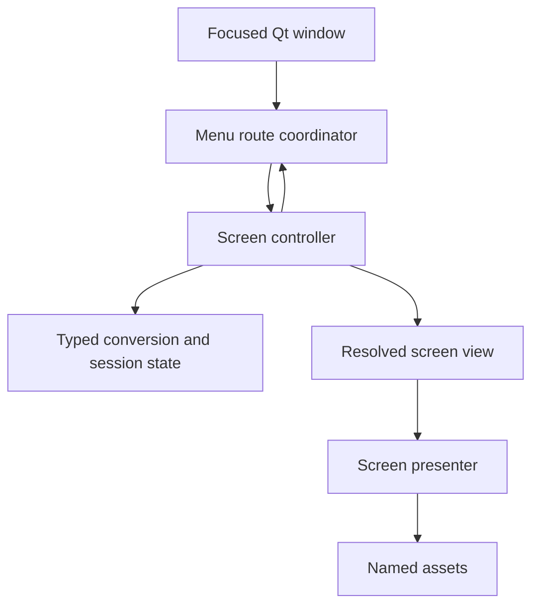

# Qt menu class design

This design gives each screen a small controller and presenter while keeping
gameplay transitions in the typed conversion/session layer. It applies to the
Ghidra-conversion Qt executable and is the migration plan for its current
`FieldSceneRuntime` menu responsibilities.

## Ownership

- The focused Qt window forwards each controller edge once.
- A screen controller forwards input edges to that screen's typed conversion
  calls and returns a view or typed route result. It owns host timing and
  presentation inputs where the source requires them.
- The conversion/session layer owns menu selections, inventory and currency
  mutations, world state, and source event transitions.
- A presenter draws one resolved view from individually named assets. It
  clears or replaces the screen region owned by that view before drawing new
  controls. A shared frame remains visible only when the source keeps it across
  the child transition.
- A route coordinator tracks the active screen and parent return route. It
  leaves each screen's source cursor and behavior with that screen's typed
  state.

## Screen map

| Screen | Qt class boundary | Existing authoritative state or behavior | Separation to make |
|---|---|---|---|
| New Game / Start Options | `StartOptionsMenuController` and `StartOptionsMenuPresenter` | `StartOptionsMenuState` and `startup_menu_conversion` | Move key handling and drawing from the window into the screen pair. |
| Save / Load | `SaveLoadMenuController` and `SaveLoadMenuPresenter` | `SaveLoadMenuState`; save validation and restore conversions | Keep slot selection and load result typed; connect real save storage through the session layer. |
| Joshua archetype | `ArchetypeMenuController` and `ArchetypeMenuPresenter` | `JoshuaArchetypeMenuState` and startup integration | Bind the three source records and selected portrait to a dedicated view. |
| In-game Start command overview | `FieldCommandMenuController` and `FieldCommandMenuPresenter` | `FieldCommandOverviewBridge`, `CommandOverviewState`, and menu service conversions | Move the command overview's page rendering and child dispatch out of `FieldSceneRuntime`. |
| Inventory grid | `InventoryMenuController` and `InventoryMenuPresenter` | Active runner record, inventory records, and item catalog | Present selection/equipment from the shared runner record. Preserve the source's one-pixel item outline and redraw the whole owned panel on entry/return. |
| Inventory action row | `InventoryActionMenuController` and `InventoryActionMenuPresenter` | `InventoryActionMenuState` and item-action conversion functions | Keep equip, discard, automatic use, First Aid, and Trade as separate typed routes. |
| Trade | `InventoryTradeMenuController` and `InventoryTradeMenuPresenter` | `InventoryTradeState` and typed roster records | Own recipient scan, full-recipient handling, quantity/confirmation, and transfer result. |
| First Aid | `FirstAidMenuController` and `FirstAidMenuPresenter` | `FirstAidUserState`, target state, and First Aid conversions | Own eligible-target selection and the result wait as a child screen, returning through a typed result. |
| Clips / reload | `ClipsMenuController` and `ClipsMenuPresenter` | `FieldClipsMenuRuntime`, `ClipTradeState`, and item capacity | Extract the current paint/input work from `FieldSceneRuntime`; preserve reload and clip-trade results. |
| Attributes / Skills | `AttributesSkillsMenuController` and `AttributesSkillsMenuPresenter` | `AttributesSkillsMenuState` and progression conversions | Read the active record and route confirmed upgrades through typed mutation functions. |
| Cyberware | `CyberwareMenuController` and `CyberwareMenuPresenter` | `CyberwareMenuModel` | Keep the current installed-bit/name view read-only until source purchase/install paths are traced. |
| Magic | `MagicMenuController` and `MagicMenuPresenter` | `MagicMenuLoopState`, `MagicForceState`, and Magic conversions | Move spell/force selection and return behavior out of `FieldSceneRuntime`; keep the defense fallback as its own source-selected branch. |
| Pocket Secretary | `PocketSecretaryMenuController` and a presenter per child page | `PocketSecretaryMenuState`, `NotebookMenuState`, and `DismissRunnerMenuState` | Give the parent, Notebook/Tips, and Dismiss Runner distinct views and route results. Rebuild the panel before a child page replaces parent controls. |
| Dialogue | `FieldDialogueEventResolver` plus `DialoguePanelPresenter` | `DialoguePanelView`, `FieldExitPromptState`, and source speaker/event records | Resolve speaker properties, trigger event, text, portrait, options, and frame mode before the generic presenter draws. Use event-specific providers for motel, building, and random street encounters. |
| Shop | `ShopMenuController`, `ShopTransactionService`, and `ShopMenuPresenter` | Ares mode/event and offer rows are traced; controller and typed transaction adapters are implemented | Connect the event-resolved dialogue and field-mode route, then add the source-positioned presenter and live session wallet binding. |

## Current runtime status

These are target class boundaries; several still describe work to extract from
their current host:

- **New Game, Save/Load, and archetype:** typed startup conversions exist, but
  `GhidraConversionWindow` still owns their input routing, callbacks, and
  painting. The three named controller/presenter pairs in the screen map have
  not been extracted.
- **In-game command overview:** `FieldCommandOverviewBridge` owns the typed
  root-page transition and resolved view. `FieldSceneRuntime` still owns its
  assets, root and child drawing, child state, and most child input routing.
- **Dialogue:** `FieldDialogueEventResolver`, `FieldDialogueRuntime`, and the
  shared `DialoguePanelPresenter` exist. Event selection is source-keyed, but
  only converted prompt branches and extracted speaker records resolve;
  Ares's separate mode-text route and other event providers remain pending.
- **Generic mode-text prompt:** the typed `0x1F3C4` conversion now exposes a
  one-frame advance API with the source 10-frame option delay, 30-frame
  sentinel delay, controller priority, and subcommand return. A Qt runtime
  provider now resolves Ares mode 2/event 11 and its positive/negative text
  variants. Its source-owned background/presenter and live field route still
  need to be connected before the shop can open through that event.
- **Shop:** `ShopMenuController` and `ShopTransactionService` exist for the
  Ares source selection and transactions. The live field route, wallet
  binding, and presenter remain pending.
- **Clips:** `FieldClipsMenuRuntime` owns the converted selector and action
  state. Its composition and several other child screens still live in
  `FieldSceneRuntime`.

The menu-class table is both the intended architecture and an extraction
checklist. It does not claim that every listed class is already in the
executable.

`GhidraConversionWindow` remains the Qt window and focused-input endpoint. The
current `FieldSceneRuntime` is the field composition host; its embedded menu
state and `paint_command_overview*` / `advance_command_overview*` methods mark
the extraction seams. `FieldCommandOverviewBridge`, `FieldClipsMenuRuntime`,
and the newly separated `DialoguePanelPresenter` show the intended shape.

## Route and drawing contract

Each controller reports one of: remain on this screen, open a source-selected
child, replace this screen with a source-selected destination, or return to
its parent. The coordinator preserves the parent's typed state while a child
is open. The destination comes from the traced event and source table.

Each presenter owns its screen rectangle. On entry or replacement it redraws
that rectangle from its named background/frame and current view, then draws
only the current controls. A child that shares the parent's frame follows the
source's clear/write order and removes old buttons, text, selectors, and item
graphics before drawing its own. Animation advances from a controller tick
only when a source counter or event requires it. Sound requests go through the
audio service with a source-derived event and measured or explicitly pending
duration.

## Shop boundary

The Ares Weapon Emporium route is scene 2/event 11 through `0x1FA78`: it sets
menu mode 1 and result -1, runs the shared mode-exit services, then enters the
`0x56AC0` field service loop. The three source offer groups are the 8-row
records at `0x1AAC9E`, `0x1AADD7`, and `0x1AAD8F`; `0x56DC4` dispatches the
selected group and cursor. Ordinary purchases use the 50-row item catalog and
`0x5794E`/`0x57A44`; Ares sales use the shared `0x56F4A` removal path and its
half-price quote with the mode-1 runner surcharge. `0x57B8C` owns the common
Yes/No confirmation.

`ShopMenuController` now retains the converted `FieldModeServiceState`, uses
the source directional precedence and panel bounds, and returns typed buy,
sell, return, runner-change, or unresolved-action requests. It does not own
wallet or inventory copies. `ShopTransactionService` delegates to the existing
typed purchase and removal conversions. The live event-to-dialogue-to-shop
route, shared wallet binding, and source-positioned `ShopMenuPresenter` remain
open, so this slice is partial and does not claim a playable Ares shop.

The Ares route is field mode 2/event 11. `0x1FA78` selects resource profile
`0x1220C0` and the mode text record at `0x110DD2`, then `0x1F246` calls the
generic text-prompt loop at `0x1F3C4` before entering `0x56AC0`. This is not the
Stoker/NPC panel route selected by `0x1F65A` for mode 2/event 2. Keep both
routes event-selected, with speaker properties and text supplied by their
source records; do not assign the Ares prompt a Stoker portrait or dialogue
record. The host mode-text prompt and Ares presenter remain pending. Its
presenter must redraw its owned panel on entry, category change, offer change,
confirmation, and return so stale buttons or graphics cannot remain beneath
the current page.

## Verification for each screen

Every screen slice answers the visual audit questions in
`visual-analysis/qt-visual-audit.md`: appearance, behavioral selection state,
source layout and visual attributes, animation cadence, sound and duration,
related screen content, multiple independent frames, and removal of prior UI.
Each implemented screen also gets a source trace, typed-state route coverage,
a focused CTest, and a CLI image dump. Independent gameplay frames remain the
appearance reference; internal assets and dumps check the conversion path.

## Migration order

1. Extract the in-game command overview and its inventory, First Aid, Trade,
   Magic, Cyberware, Pocket Secretary, and Clips children from
   `FieldSceneRuntime`, one screen slice at a time.
2. Move Start Options, Save/Load, and Archetype handling out of the Qt window
   into their screen controllers and presenters.
3. Separate dialogue event resolution from the generic panel. Connect each
   provider from its speaker properties and field/building/encounter event.
4. Connect the traced Ares/shop route, generic event dialogue, shared wallet,
   and `ShopMenuPresenter` around the implemented controller/transaction
   layer.

The dialogue frame/presenter slice is committed as `18ae07ba42` and remains
partial while live speaker/event resolution and other event branches are open.
